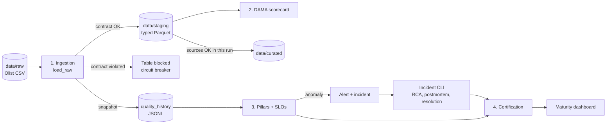

# Olist E-Commerce — Data Quality & Observability


[](docs/README.md)

**A pipeline can finish without a single error and still deliver wrong data.**

This project applies the ideas of *Data Quality Fundamentals* (Barr Moses, Lior Gavish and Molly Vorwerck, O'Reilly) end to end to the [Brazilian E-Commerce Public Dataset by Olist](https://www.kaggle.com/datasets/olistbr/brazilian-ecommerce). With a single command, 9 tables and about 1.55 million rows go from raw CSV to a certified analytical layer, through data contracts, a quality scorecard, observability, SLOs, incident management and certification.

**Documentation:** [English](docs/en/README.md) · [Português](docs/pt-BR/README.md)

## Why

The book calls it **data downtime**: periods when data is partial, erroneous, missing or otherwise inaccurate, even though every job finished green. Monitoring whether a job *ran* is not enough; you have to monitor whether the data is *right*. The book estimates it as:

```
data downtime = number of incidents × (time to detection + time to resolution)
```

Each stage of this project pulls one of those levers: contracts prevent incidents, observability shortens detection, and the incident process shortens resolution.

## What it does

| Stage | Question it answers | How |
|---|---|---|
| **1. Ingestion with data contracts** | Does this data meet the agreement? | One YAML contract per table (schema, types, nullability, keys, accepted values, ranges, minimum volume) and a **per-table circuit breaker**: a table that breaks its contract never reaches staging, while the others keep flowing |
| **2. DAMA quality scorecard** | How good is this data, in %? | Completeness, uniqueness, validity and cross-table consistency on the typed staging layer |
| **3. Observability** | Did the data change in a way nobody anticipated? | Freshness, volume, schema, distribution and lineage pillars over the run history, SLOs per table and pillar, alerts and incidents with downstream impact and time to detection |
| **4. Trust and response** | Can I use this data? Who was affected? What did we learn? | Curated layer with **field-level lineage**, table **certification**, an incident CLI (5 Whys RCA, blameless postmortem, time to resolution) and a **maturity dashboard** |

## Architecture



Behavior is driven by metadata: the catalog (`catalog/inventory.yaml`), one contract per table (`contracts/`) and the SLOs (`config/slo.yaml`). Tightening a rule, declaring a new relationship or adding an SLO requires no Python.

## See it in action

`scripts/simulate_incident.py` breaks one raw CSV at a time on purpose. Every result below was reproduced on a fresh clone, starting from 4 clean baseline runs:

| Scenario | What breaks | Contract | What catches it |
|---|---|---|---|
| `contract_violation` | 10 negative prices in `order_items` | **Blocks** the table | Circuit breaker: only `order_items` stops, the other 8 tables go through and the curated layer is not rebuilt |
| `volume_drop` | Last 8% of `orders` removed | Passes (91,485 rows ≥ 90,000) | Volume pillar: Z = −8.00, critical alert, 3 downstream tables impacted, SLO breached, certification lost |
| `distribution_shift` | `freight_value` × 3 | Passes (freight only has `min_value: 0`) | Distribution pillar: mean freight jumps to 59.97 (Z = 200), SLO breached |
| `null_spike` | 30% of product categories nulled | Passes (`nullable: true`) | Null-rate shift to 31.29% (Z ≈ 1,590): incident and certification lost, no SLO breached |
| `schema_drift` | New column in `order_reviews` | Only warns | Schema pillar: SLO breached |

The `volume_drop` run, condensed:

```
[ingestion] completed: 9/9 tables processed successfully.
[ALERT-CRITICAL] [VOLUME] orders: 91485 rows (Z-score=-8.00, baseline[moving]: mean=99441, std=994). | downstream impact: order_items, order_payments, order_reviews
[certify] orders: not certified
SLOs breached: ['orders_volume_stability']
Certified tables: 8/9
```

No fixed rule would have caught it: the contract only demands 90,000 rows. Statistics over the run history did. After the data is restored, the next run raises **no** false alarm, because the anomalous point is pruned from the baseline, and `orders` is certified again only after someone records the resolution through the incident CLI.

## What the data revealed

Profiling and cross-table checks surfaced behaviors that look like errors but belong to the dataset. Each one is handled explicitly instead of being silently "fixed":

- `review_id` is not unique: it repeats 814 times across different orders, so the primary key is `(review_id, order_id)`.
- 278 customers and 7 sellers have ZIP code prefixes with no coordinates in `geolocation` (consistency of 99.72% and 99.77% in the DAMA scorecard).
- 13 products belong to 2 categories that have no English translation.
- `customer_id` is one id per order: 99,441 ids map to 96,096 people (`customer_unique_id`).
- 9,803 orders have more than one item, so the curated layer keeps the per-item value (`item_total_value`) apart from the aggregated order total (`order_total_value`).

## Engineering highlights

- **One verdict per (table, pillar) per run.** Alerts, incidents, SLOs, certification and the dashboard read the same evaluation, so they never disagree.
- **Every rule lives in one place.** A single function decides whether a value is valid: the contract counts the violations (pass/fail) and the DAMA scorecard turns them into percentages.
- **Robust anomaly detection.** A moving baseline of the last 10 runs, median/MAD outlier pruning so an old incident does not hide new ones, and a standard deviation floor so a constant history does not alarm on a single missing row.
- **Absence of evidence is not evidence.** Without enough history a pillar answers `insufficient_history`: it never breaks an SLO, but it never certifies a table either.
- **No alert fatigue.** Incidents are keyed by (table, pillar, snapshot), so re-running the checks on unchanged data opens nothing new.
- **Testable by design.** Pure functions with a thin I/O shell: 172 unit tests run in about a second without the dataset, and guard tests keep the contracts in sync with the catalog and the lineage registry in sync with the code.
- **Documented trade-offs.** 17 architecture decisions (context → decision → why → accepted cost), the known limitations and the production alternatives.

## Quick start

Requirements: Python 3.11+ and [Poetry](https://python-poetry.org/) 2.x.

```bash
poetry install
```

**1. Get the data.** Download the 9 Olist CSVs into `data/raw/` (see [`scripts/download_instructions.md`](scripts/download_instructions.md)).

**2. Build the baseline and run the whole pipeline** (ingestion, DAMA, pillars and SLOs, certification, curated layer and dashboard):

```bash
poetry run python -m src.ingestion.load_raw          # run 3 times to build the baseline
poetry run python -m orchestration.local_pipeline    # ends with 9/9 tables certified
```

The statistical pillars need 3 previous runs; until then they answer `insufficient_history` and nothing is certified. The pipeline exits with code `1` when a table is blocked or an SLO is breached, and an optional webhook (e.g. Slack) also receives the alerts when `ALERT_WEBHOOK_URL` holds an `https://` URL.

**3. Break something and watch it get caught:**

```bash
poetry run python -m scripts.simulate_incident list
poetry run python -m scripts.simulate_incident volume_drop
poetry run python -m orchestration.local_pipeline
poetry run python -m scripts.simulate_incident restore
```

**4. Close the loop with the incident CLI** (ids accept any unique prefix):

```bash
poetry run python -m src.incidents.cli list
poetry run python -m src.incidents.cli rca <id> --why "..." --why "..." --root-cause "..." --by "<name>"
poetry run python -m src.incidents.cli postmortem <id> --impact "..." --timeline "..." --action "..."
poetry run python -m src.incidents.cli resolve <id> --summary "..."
```

**Tests and lint:**

```bash
poetry run pytest
poetry run ruff check .
```

Every stage can also run on its own; see [Running and testing](docs/en/06-running-and-testing.md).

## Documentation

`docs/` holds the full study material, in English and Portuguese: the book's theory linked to the code, the architecture decisions, a reference of every module, every configuration key, and how to run, test and simulate incidents.

| | English | Português |
|---|---|---|
| Overview | [1. Overview](docs/en/01-overview.md) | [1. Visão geral](docs/pt-BR/01-visao-geral.md) |
| Theory → code | [2. Theoretical foundations](docs/en/02-theoretical-foundations.md) | [2. Fundamentos teóricos](docs/pt-BR/02-fundamentos-teoricos.md) |
| Design | [3. Architecture](docs/en/03-architecture.md) | [3. Arquitetura](docs/pt-BR/03-arquitetura.md) |
| Modules | [4. Code reference](docs/en/04-code-reference.md) | [4. Referência de código](docs/pt-BR/04-referencia-de-codigo.md) |
| YAML keys | [5. Configuration](docs/en/05-configuration.md) | [5. Configuração](docs/pt-BR/05-configuracao.md) |
| Run and simulate | [6. Running and testing](docs/en/06-running-and-testing.md) | [6. Execução e testes](docs/pt-BR/06-execucao-e-testes.md) |
| Review | [7. Study guide](docs/en/07-study-guide.md) | [7. Guia de estudo](docs/pt-BR/07-guia-de-estudo.md) |

## Project structure

```
catalog/inventory.yaml        metadata of the 9 tables: file, keys, criticality, owner, known gotchas
config/settings.yaml          paths per environment
config/slo.yaml               SLOs per table and pillar
contracts/*.contract.yaml     one data contract per table
orchestration/                the whole pipeline in one command
scripts/simulate_incident.py  incident simulator
src/ingestion/                ingestion, contract validator and type casting
src/quality/                  DAMA scorecard, observability pillars, SLOs and checks runner
src/monitoring/               snapshot history, anomaly detection and alerting
src/incidents/                incident log (TTD / TTR), RCA, postmortem and CLI
src/transform/                curated layer
src/lineage/                  field-level lineage registry
src/certification/            table certification
src/reporting/                maturity dashboard
tests/                        172 unit tests
docs/                         full documentation (en / pt-BR)
data/, reports/               generated at runtime (not versioned)
```

## Tech stack

Python 3.11+ · pandas · PyArrow (Parquet) · PyYAML · Poetry · pytest · Ruff

## Acknowledgments

- *Data Quality Fundamentals*, by Barr Moses, Lior Gavish and Molly Vorwerck (O'Reilly): the book this project puts into practice.
- [Brazilian E-Commerce Public Dataset by Olist](https://www.kaggle.com/datasets/olistbr/brazilian-ecommerce), on Kaggle. The data is not redistributed in this repository.
