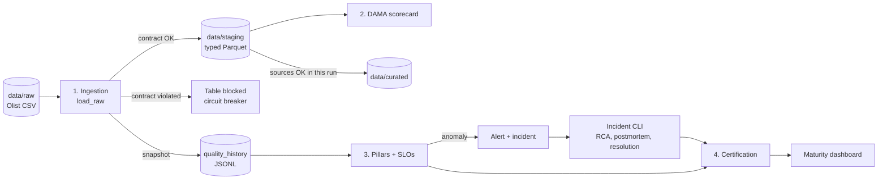

# 1. Overview

> [Index](README.md) · Next: [2. Theoretical foundations](02-theoretical-foundations.md)

## 1.1 The problem: a "green" pipeline can deliver wrong data

A data job can finish without a single error and still deliver:

- an entirely empty column;
- half of yesterday's rows;
- prices multiplied by ten because a unit changed at the source;
- a new column that breaks a dashboard three teams downstream.

The book **Data Quality Fundamentals** (Barr Moses, Lior Gavish and Molly Vorwerck, O'Reilly) calls this period **data downtime**: the time when data is partial, erroneous, missing or otherwise inaccurate. The book's central point is that monitoring whether the *job ran* is not enough; you have to monitor whether the *data is right*.

This project applies the book's tools to the [Brazilian E-Commerce Public Dataset by Olist](https://www.kaggle.com/datasets/olistbr/brazilian-ecommerce): 9 tables and about 1.55 million rows of orders, items, payments, reviews, products, sellers, customers and geolocation from a Brazilian marketplace, between 2016 and 2018.

## 1.2 What the project delivers

A local pipeline, run with a single command, that takes the data from the raw CSV to a certified analytical layer. Along the way it applies four layers of defense and one of response:

| Stage | Question it answers | Mechanism |
|---|---|---|
| 1. Ingestion with contracts | "Does this data meet the agreement?" | Data contract + per-table circuit breaker |
| 2. DAMA dimensions | "How good is this data, in %?" | Completeness, uniqueness, validity, consistency |
| 3. Observability | "Did this data change in a way nobody anticipated?" | Pillars (freshness, volume, schema, distribution, lineage), SLOs, alerts, incidents |
| 4. Trust and response | "Can I use this data? Who was affected? What did we learn?" | Curated layer, field-level lineage, certification, RCA, postmortem, maturity dashboard |

## 1.3 End-to-end flow



How to read the diagram:

1. Every table goes through the contract before reaching staging. A table that violates its contract is blocked **on its own**; the others continue.
2. Every approved ingestion writes a metrics **snapshot**. This history is the memory the observability pillars use to detect deviations.
3. An anomaly raises an alert and an incident. A person investigates and resolves it through the CLI; only then is the table certified again.

## 1.4 Principles behind the code

These principles show up again and again in the decisions described in [3. Architecture](03-architecture.md):

1. **Metadata-driven.** Behavior comes from YAML files (catalog, contracts, SLOs). Tightening a rule or adding a table does not require touching Python.
2. **Every decision in a single place.** What a "valid value" is, what a "volume anomaly" is and where files live are defined once and reused by every module.
3. **Defense in depth.** Declared rules catch what is already known to be wrong; statistics over the history catch what nobody anticipated.
4. **Pure functions with a thin I/O shell.** The logic receives DataFrames and dictionaries and returns results; reading and writing files stays at the edges. This makes almost everything testable without touching disk.
5. **Absence of evidence is not evidence.** Without enough history, the system says "I don't know" (`insufficient_history`): it never becomes an SLO failure, but it never becomes a certification either.

## 1.5 Repository structure

```
catalog/inventory.yaml         metadata of the 9 tables: file, PK, FKs, criticality, owner, gotchas
config/settings.yaml           paths per environment
config/slo.yaml                SLOs per table and pillar
contracts/*.contract.yaml      one data contract per table
data/raw/                      original CSVs (not versioned)
data/staging/                  validated and typed Parquet (not versioned)
data/curated/                  analytical tables with derived fields (not versioned)
reports/                       outputs of each run (not versioned, only the .gitkeep files)
orchestration/local_pipeline.py   the whole pipeline in one command
scripts/simulate_incident.py   incident simulator for study
src/config.py                  settings and catalog loading
src/ingestion/                 ingestion, contract and type casting
src/quality/                   DAMA, pillars, SLOs and checks runner
src/monitoring/                snapshot history, anomaly detection, alerts
src/incidents/                 incident log, RCA, postmortem and CLI
src/transform/                 curated layer
src/lineage/                   field-level lineage registry
src/certification/             table certification
src/reporting/                 maturity dashboard
tests/                         172 unit tests
```

## 1.6 How to read this documentation

| If you want to... | Read |
|---|---|
| Understand the book's theory as applied here | [2. Theoretical foundations](02-theoretical-foundations.md) |
| Understand why the project is designed this way | [3. Architecture](03-architecture.md) |
| Know what each function does, its parameters and returns | [4. Code reference](04-code-reference.md) |
| Change rules, SLOs or tables | [5. Configuration](05-configuration.md) |
| Run the project, test it and simulate incidents | [6. Running and testing](06-running-and-testing.md) |
| Review the material and learn the limits | [7. Study guide](07-study-guide.md) |
