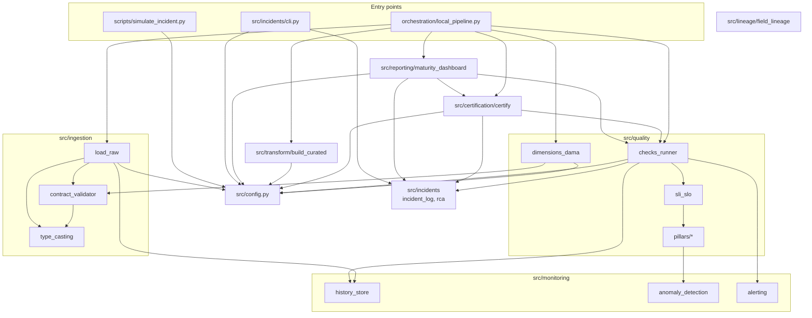
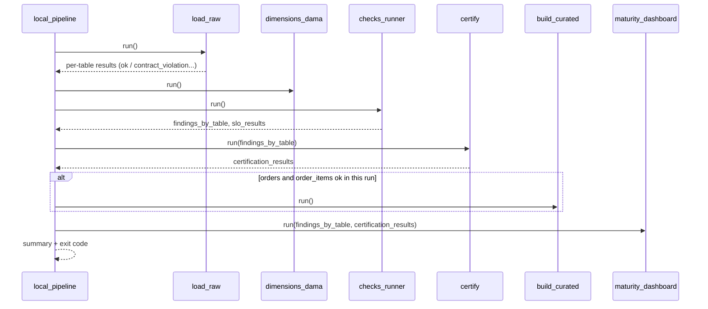

# 3. Architecture

> [Index](README.md) · Previous: [2. Theoretical foundations](02-theoretical-foundations.md) · Next: [4. Code reference](04-code-reference.md)

## 3.1 Data layers

| Layer | Folder | Format | Guarantee |
|---|---|---|---|
| **Raw** | `data/raw/` | CSV, as downloaded from Kaggle | None: it is the source |
| **Staging** | `data/staging/` | Parquet, one per table | Met its contract and is typed accordingly |
| **Curated** | `data/curated/` | Parquet | Built only from staging approved **in the same run**, with derived fields documented by lineage |

**Why three layers.** Each layer carries a different trust contract. Whoever reads staging knows types and rules were checked. Whoever reads curated also knows where each derived field comes from. Raw stays untouched, which allows reprocessing everything and returning to the original after a simulation.

**Why Parquet in staging.** CSV does not store types: everything is text. In Parquet, `order_purchase_timestamp` comes out as `datetime` and `order_item_id` as `Int64`, so consumers do not need to convert again. Being columnar, Parquet also allows reading a single column, which the DAMA scorecard takes advantage of.

## 3.2 Modules and dependencies

The graph **has no cycles** and follows a simple rule: mechanism modules (`type_casting`, `anomaly_detection`, `pillars/*`, `history_store`) do not know the modules that use them. The pillars, for example, know how to compute a Z-score, but not what an SLO, an alert or an incident is.

## 3.3 Architecture decisions

Each decision follows the format: context → decision → why → accepted cost.

### D1. Metadata-driven

- **Context:** quality rules change often, and the people who know them do not always program.
- **Decision:** behavior comes from YAML: `catalog/inventory.yaml` (what exists), `contracts/` (what each table must satisfy), `config/slo.yaml` (the targets) and `config/settings.yaml` (where things live).
- **Why:** adding an FK to the catalog makes the Consistency dimension measure it and the lineage graph include it, without a line of Python. Tightening the maximum price means editing a number.
- **Cost:** a typo in the YAML only shows up at runtime. Mitigation: `tests/test_contracts.py` and `tests/test_slo.py` validate the consistency of the YAMLs.

### D2. Contract before staging; observability after

- **Context:** there are two kinds of problems: known ones (negative price) and unforeseen ones (an 8% drop in volume).
- **Decision:** the contract **blocks** at the entrance; the pillars **detect** over the history afterwards.
- **Why:** defense in depth. The simulator's `volume_drop` scenario shows it: 91,485 rows pass the contract (minimum 90,000), but the volume pillar catches the drop with Z = −8.
- **Cost:** two mechanisms to maintain. The shared function `column_rule_violations()` (D5) keeps them from diverging.

### D3. Per-table circuit breaker

- **Decision:** a violation blocks only the table that violated; the loop continues.
- **Why:** stopping everything because of a low-criticality table (`category_translation`) would cause more downtime than the problem itself.
- **Cost:** staging may hold tables from different runs. Mitigation: the curated layer is rebuilt only when its sources passed **in this** run (D12), and the freshness pillar exposes the table left behind.

### D4. Snapshots only for approved data

- **Decision:** `append_snapshot()` is called only after the contract passes.
- **Why:** the history is the statistical baseline. A snapshot of known-bad data would contaminate it. Also, without a new snapshot the blocked table ages, and the freshness SLO exposes it without any extra code.

### D5. Every decision in a single place

The project went through several refactorings to remove duplications that had already caused inconsistencies:

| What | Single place | Used by |
|---|---|---|
| Project root, settings, catalog | `src/config.py` | All entry points |
| "Is this value valid?" | `column_rule_violations()` | Contract (counts) and DAMA (percentage) |
| Type conversion | `TYPE_CASTERS` | Contract (detects) and ingestion (writes typed data) |
| Parameters of a pillar | `pillar_params()` | Runner, SLOs, certification, dashboard |
| Evaluation of a table | `evaluate_table()` / `evaluate_catalog()` | Runner, certification, dashboard |

- **Why:** before the unification, the runner evaluated freshness with 24h for every table, while the SLO for `products` said 48h. After 30h without a load, an incident was opened while the SLO said "ok". With a single place, the alert, the incident, the SLO, the certification and the dashboard read **the same verdict**.

### D6. Pure functions with a thin I/O shell

- **Decision:** logic lives in functions that receive and return data (`score_table`, `curate_orders`, `certify_all`, `compute_kpis`, `evaluate_slos`). Reading and writing live in `run()` functions.
- **Why:** testability. The 172 tests run in under 1 second and none of them reads `data/raw/`. The DAMA `consistency()` receives the parent-table lookup as a parameter (dependency injection), so the test passes an in-memory dictionary.

### D7. History in JSON Lines, append-only

- **Decision:** `reports/quality_history/<table>.jsonl`, one line per run.
- **Why:** simple, readable, auditable, and no database required. Appending a line is atomic enough for a single process.
- **Cost:** no concurrency control and no queries. For production, the natural path is a table in a warehouse.

### D8. Moving, robust baseline

- **Decision:** the statistical pillars default to `method: moving` (last 10 runs), with median/MAD outlier pruning and a standard deviation floor of 1% of the mean.
- **Why:** each component solves a concrete problem, reproduced in the tests (see [2.6](02-theoretical-foundations.md#26-anomaly-detection)). In the simulator, after `volume_drop` and the restore, the next run raised **no** false alarm: the pruning discarded the anomalous point from the baseline.

### D9. "No evidence" never fails an SLO, but never certifies

- **Decision:** `insufficient_history` counts as SLO met, but prevents certification.
- **Why:** the asymmetry is deliberate. Failing an SLO without data would raise false alarms in every new project. Certifying without data would grant a trust seal with no basis.

### D10. One incident per (table, pillar, snapshot)

- **Context:** the runner always re-evaluates the latest snapshot. Without new data, the same problem would be reopened on every run.
- **Decision:** the incident stores `snapshot_at`, and `find_incident()` prevents a duplicate.
- **Why:** repeated alerts train people to ignore alerts. New data produces a new snapshot and, if the problem persists, a new incident.

### D11. Severity from the table's own criticality

- **Alternative considered:** use the worst criticality among all impacted tables.
- **Why it was discarded:** with foreign keys as lineage, almost every table reaches `orders` (criticality `high`), and every alert would become critical. Severity comes from the source table, and the incident **lists** the impacted tables for triage.

### D12. Curated layer gated on the same run's ingestion

- **Decision:** the orchestrator calls `build_curated` only if `orders` and `order_items` passed their contract in that run.
- **Why:** if `order_items` was blocked, staging still holds the Parquet from the previous run. Rebuilding curated would mix new `orders` data with old `order_items` data.

### D13. Declared field-level lineage, with a guard test

- **Context:** with SQL, lineage can be extracted by parsing the queries. With pandas, there is nothing to parse.
- **Decision:** an explicit registry in `field_lineage.py`, plus a test that compares the columns created by the code with those declared in the registry.
- **Why:** a manual registry tends to fall out of date. The test turns that silent drift into a visible failure on the next `pytest` run.

### D14. Generated state outside versioned folders

- **Decision:** everything the pipeline generates lives in `data/` and `reports/` (ignored by Git). `catalog/` and `config/` contain only what people edit.
- **Why:** certification, for example, used to write to `catalog/`, and the file would show up as modified in Git on every run.

### D15. No emoji in the console, emoji in Markdown

- **Why:** the Windows console uses cp1252 by default, and a `print` with ✅ crashes the process with `UnicodeEncodeError`. This error broke three modules during development. File reports are written in UTF-8 and may use emoji.

### D16. Exit codes as a contract with the orchestrator

| Command | Exit 1 when |
|---|---|
| `src.ingestion.load_raw` | Some table did not reach staging |
| `src.quality.checks_runner` | Some SLO was breached |
| `orchestration.local_pipeline` | A table was blocked or an SLO was breached |
| `src.incidents.cli` | Usage error (unknown id, double resolution, missing RCA) |

An incident without a breached SLO (the `null_spike` on `products`, which only has a freshness SLO) does **not** change the exit code: it shows up in the alert, the incident and the certification. That is the difference between "something changed" and "a commitment was broken".

### D17. Optional, HTTPS-only webhook that never brings the pipeline down

- **Decision:** if `ALERT_WEBHOOK_URL` is set and starts with `https://`, the alert is also sent there; any network failure is logged and ignored.
- **Why:** an alert must not cause an incident. The `https://` restriction prevents `urlopen` from reading local files (`file://`).

## 3.4 Sequence of a full run

The findings from step 3 are passed on to certification and to the dashboard. The pillars are evaluated **once per run**, and when certification or the dashboard run on their own, they call `evaluate_catalog()`, which produces exactly the same result.

## 3.5 Accepted costs and production alternatives

| Local choice | Why it works here | In production |
|---|---|---|
| In-memory pandas | 1.55 million rows fit in memory; the full ingestion takes a few seconds | Spark, DuckDB or the warehouse |
| Sequential, single-process run | Easy to understand and debug | An orchestrator (Airflow, Dagster) with parallelism |
| JSONL for history, alerts and incidents | Zero infrastructure, easy to inspect | Warehouse tables, an incident tool |
| SLO evaluated per run | Didactic: each run has a clear verdict | SLO over a window ("99% of the month's runs") |
| Lineage via foreign keys | The catalog already declares the FKs | Lineage extracted from queries and jobs |
