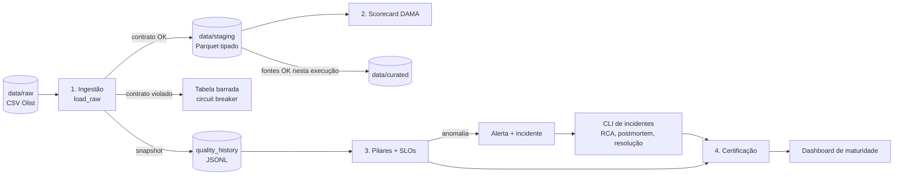

# 1. Visão geral

> [Índice](README.md) · Próximo: [2. Fundamentos teóricos](02-fundamentos-teoricos.md)

## 1.1 O problema: um pipeline "verde" pode entregar dado errado

Um job de dados pode terminar sem nenhum erro e, ainda assim, entregar:

- uma coluna inteira vazia;
- metade das linhas de ontem;
- preços multiplicados por dez porque uma unidade mudou na origem;
- uma coluna nova que quebra um dashboard três times adiante.

O livro **Data Quality Fundamentals** (Barr Moses, Lior Gavish e Molly Vorwerck, O'Reilly) chama esse período de **data downtime**: o tempo em que os dados estão parciais, errados, ausentes ou imprecisos. O ponto central do livro é que monitorar se o *job rodou* não basta; é preciso monitorar se o *dado está certo*.

Este projeto aplica as ferramentas do livro ao [Brazilian E-Commerce Public Dataset by Olist](https://www.kaggle.com/datasets/olistbr/brazilian-ecommerce): 9 tabelas e cerca de 1,55 milhão de linhas de pedidos, itens, pagamentos, avaliações, produtos, vendedores, clientes e geolocalização de um marketplace brasileiro, entre 2016 e 2018.

## 1.2 O que o projeto entrega

Um pipeline local, executado com um único comando, que leva os dados do CSV bruto até uma camada analítica certificada. Ao longo do caminho, ele aplica quatro camadas de defesa e uma de resposta:

| Etapa | Pergunta que responde | Mecanismo |
|---|---|---|
| 1. Ingestão com contratos | "Este dado cumpre o combinado?" | Contrato de dados + circuit breaker por tabela |
| 2. Dimensões DAMA | "Quão bom é este dado, em %?" | Completude, unicidade, validade, consistência |
| 3. Observabilidade | "Este dado mudou de um jeito que ninguém previu?" | Pilares (freshness, volume, schema, distribution, lineage), SLOs, alertas, incidentes |
| 4. Confiança e resposta | "Posso usar este dado? Quem foi afetado? O que aprendemos?" | Camada curada, lineage de campo, certificação, RCA, postmortem, dashboard de maturidade |

## 1.3 Fluxo de ponta a ponta



Leitura do diagrama:

1. Toda tabela passa pelo contrato antes de chegar ao staging. Uma tabela que viola o contrato é barrada **sozinha**; as outras seguem.
2. Toda ingestão aprovada grava um **snapshot** de métricas. Esse histórico é a memória que os pilares de observabilidade usam para detectar desvios.
3. Uma anomalia gera alerta e incidente. Uma pessoa investiga e resolve pela CLI; só então a tabela volta a ser certificada.

## 1.4 Princípios que guiam o código

Estes princípios aparecem repetidamente nas decisões descritas em [3. Arquitetura](03-arquitetura.md):

1. **Orientado a metadados.** O comportamento vem de arquivos YAML (catálogo, contratos, SLOs). Endurecer uma regra ou incluir uma tabela não exige mexer em Python.
2. **Cada decisão em um único lugar.** O que é "valor válido", o que é "anomalia de volume" e onde ficam os arquivos é definido uma vez e reutilizado por todos os módulos.
3. **Defesa em profundidade.** Regras declaradas pegam o que já se sabe que é errado; a estatística sobre o histórico pega o que ninguém previu.
4. **Funções puras com uma casca fina de I/O.** A lógica recebe DataFrames e dicionários e devolve resultados; ler e gravar arquivos fica nas bordas. Isso torna quase tudo testável sem disco.
5. **Falta de evidência não é evidência.** Sem histórico suficiente, o sistema diz "não sei" (`insufficient_history`): isso nunca vira falha de SLO, mas também nunca vira certificação.

## 1.5 Estrutura do repositório

```
catalog/inventory.yaml         metadados das 9 tabelas: arquivo, PK, FKs, criticidade, dono, gotchas
config/settings.yaml           caminhos por ambiente
config/slo.yaml                SLOs por tabela e pilar
contracts/*.contract.yaml      um contrato de dados por tabela
data/raw/                      CSVs originais (não versionado)
data/staging/                  Parquet validado e tipado (não versionado)
data/curated/                  tabelas analíticas com campos derivados (não versionado)
reports/                       saídas de cada execução (não versionado, só os .gitkeep)
orchestration/local_pipeline.py   pipeline completo em um comando
scripts/simulate_incident.py   simulador de incidentes para estudo
src/config.py                  carregamento de settings e catálogo
src/ingestion/                 ingestão, contrato e conversão de tipos
src/quality/                   DAMA, pilares, SLOs e runner de checagens
src/monitoring/                histórico de snapshots, detecção de anomalias, alertas
src/incidents/                 log de incidentes, RCA, postmortem e CLI
src/transform/                 camada curada
src/lineage/                   registro de lineage de campo
src/certification/             certificação de tabelas
src/reporting/                 dashboard de maturidade
tests/                         172 testes unitários
```

## 1.6 Como ler esta documentação

| Se você quer... | Leia |
|---|---|
| Entender a teoria do livro aplicada aqui | [2. Fundamentos teóricos](02-fundamentos-teoricos.md) |
| Entender por que o projeto é desenhado assim | [3. Arquitetura](03-arquitetura.md) |
| Saber o que cada função faz, seus parâmetros e retornos | [4. Referência de código](04-referencia-de-codigo.md) |
| Alterar regras, SLOs ou tabelas | [5. Configuração](05-configuracao.md) |
| Rodar o projeto, testar e simular incidentes | [6. Execução e testes](06-execucao-e-testes.md) |
| Revisar o conteúdo e conhecer os limites | [7. Guia de estudo](07-guia-de-estudo.md) |
