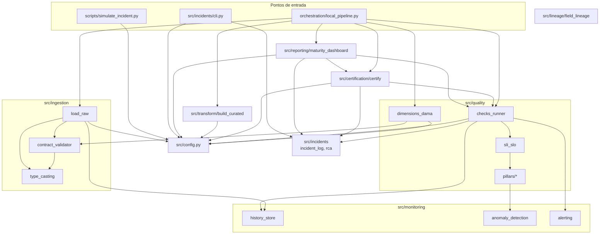
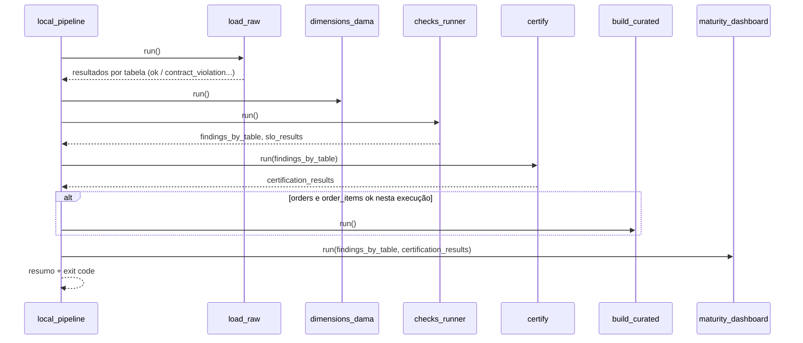

# 3. Arquitetura

> [Índice](README.md) · Anterior: [2. Fundamentos teóricos](02-fundamentos-teoricos.md) · Próximo: [4. Referência de código](04-referencia-de-codigo.md)

## 3.1 Camadas de dados

| Camada | Pasta | Formato | Garantia |
|---|---|---|---|
| **Raw** | `data/raw/` | CSV, como veio do Kaggle | Nenhuma: é a fonte |
| **Staging** | `data/staging/` | Parquet, um por tabela | Cumpriu o contrato e está tipado conforme ele |
| **Curated** | `data/curated/` | Parquet | Construído só a partir de staging aprovado **na mesma execução**, com campos derivados documentados por lineage |

**Por que três camadas.** Cada camada tem um contrato de confiança diferente. Quem lê o staging sabe que os tipos e as regras foram verificados. Quem lê o curated sabe também de onde vem cada campo derivado. O raw fica intocado, o que permite reprocessar tudo e voltar ao original depois de uma simulação.

**Por que Parquet no staging.** O CSV não guarda tipo: tudo é texto. No Parquet, `order_purchase_timestamp` sai como `datetime` e `order_item_id` como `Int64`, e quem consome não precisa converter de novo. Por ser colunar, o Parquet também permite ler uma única coluna, o que o scorecard DAMA aproveita.

## 3.2 Módulos e dependências

O grafo **não tem ciclos** e segue uma regra simples: módulos de mecanismo (`type_casting`, `anomaly_detection`, `pillars/*`, `history_store`) não conhecem os módulos que os usam. Os pilares, por exemplo, sabem calcular um Z-score, mas não sabem o que é um SLO, um alerta ou um incidente.

## 3.3 Decisões de arquitetura

Cada decisão segue o formato: contexto → decisão → por quê → custo aceito.

### D1. Orientado a metadados

- **Contexto:** regras de qualidade mudam com frequência e quem as conhece nem sempre programa.
- **Decisão:** o comportamento vem de YAML: `catalog/inventory.yaml` (o que existe), `contracts/` (o que cada tabela precisa cumprir), `config/slo.yaml` (as metas) e `config/settings.yaml` (onde ficam as coisas).
- **Por quê:** incluir uma FK no catálogo faz a dimensão Consistency medi-la e o grafo de lineage incluí-la, sem uma linha de Python. Endurecer o preço máximo é editar um número.
- **Custo:** um erro de digitação no YAML só aparece em execução. Mitigação: `tests/test_contracts.py` e `tests/test_slo.py` validam a coerência dos YAMLs.

### D2. Contrato antes do staging; observabilidade depois

- **Contexto:** existem dois tipos de problema: os conhecidos (preço negativo) e os imprevistos (queda de 8% no volume).
- **Decisão:** o contrato **bloqueia** na entrada; os pilares **detectam** sobre o histórico, depois.
- **Por quê:** é defesa em profundidade. O cenário `volume_drop` do simulador mostra isso: 91.485 linhas passam no contrato (mínimo 90.000), mas o pilar de volume pega a queda com Z = −8.
- **Custo:** dois mecanismos para manter. A função compartilhada `column_rule_violations()` (D5) evita que eles divirjam.

### D3. Circuit breaker por tabela

- **Decisão:** uma violação bloqueia só a tabela que violou; o laço continua.
- **Por quê:** parar tudo por causa de uma tabela de baixa criticidade (`category_translation`) seria um downtime maior do que o problema.
- **Custo:** o staging pode ficar com tabelas de execuções diferentes. Mitigação: a camada curada só é reconstruída quando suas fontes passaram **nesta** execução (D12), e o pilar de freshness denuncia a tabela que ficou para trás.

### D4. Snapshot só para dado aprovado

- **Decisão:** `append_snapshot()` só é chamada depois que o contrato passa.
- **Por quê:** o histórico é a linha de base estatística. Um snapshot de dado sabidamente ruim contaminaria essa linha de base. Além disso, sem snapshot novo a tabela barrada envelhece, e o SLO de freshness a denuncia sem nenhum código extra.

### D5. Cada decisão em um único lugar

O projeto passou por várias refatorações para eliminar duplicações que já tinham causado inconsistências:

| O que | Lugar único | Quem usa |
|---|---|---|
| Raiz do projeto, settings, catálogo | `src/config.py` | Todos os pontos de entrada |
| "Este valor é válido?" | `column_rule_violations()` | Contrato (conta) e DAMA (porcentagem) |
| Conversão de tipos | `TYPE_CASTERS` | Contrato (detecta) e ingestão (grava tipado) |
| Parâmetros de um pilar | `pillar_params()` | Runner, SLOs, certificação, dashboard |
| Avaliação de uma tabela | `evaluate_table()` / `evaluate_catalog()` | Runner, certificação, dashboard |

- **Por quê:** antes da unificação, o runner avaliava freshness com 24h para todas as tabelas, enquanto o SLO de `products` dizia 48h. Com 30h sem carga, abria-se um incidente enquanto o SLO dizia "ok". Com um lugar só, o alerta, o incidente, o SLO, a certificação e o dashboard leem **o mesmo veredito**.

### D6. Funções puras com casca fina de I/O

- **Decisão:** a lógica fica em funções que recebem e devolvem dados (`score_table`, `curate_orders`, `certify_all`, `compute_kpis`, `evaluate_slos`). Leitura e escrita ficam em funções `run()`.
- **Por quê:** testabilidade. Os 172 testes rodam em menos de 1 segundo e nenhum lê `data/raw/`. A `consistency()` do DAMA recebe a consulta à tabela pai como parâmetro (injeção de dependência), então o teste passa um dicionário em memória.

### D7. Histórico em JSON Lines, append-only

- **Decisão:** `reports/quality_history/<tabela>.jsonl`, uma linha por execução.
- **Por quê:** é simples, legível, auditável e não exige banco de dados. Acrescentar uma linha é atômico o suficiente para um processo único.
- **Custo:** não há controle de concorrência nem consultas. Para produção, o caminho natural é uma tabela num warehouse.

### D8. Linha de base móvel e robusta

- **Decisão:** os pilares estatísticos usam por padrão `method: moving` (últimas 10 execuções), com poda de outliers por mediana/MAD e piso de desvio-padrão de 1% da média.
- **Por quê:** cada componente resolve um problema concreto, reproduzido nos testes (ver [2.6](02-fundamentos-teoricos.md#26-detecção-de-anomalias-capítulo-4)). No simulador, depois do `volume_drop` e da restauração, a execução seguinte **não** abriu falso alarme: a poda descartou o ponto anômalo da linha de base.

### D9. "Sem evidência" nunca falha um SLO, mas nunca certifica

- **Decisão:** `insufficient_history` conta como SLO cumprido, mas impede a certificação.
- **Por quê:** a assimetria é proposital. Reprovar um SLO sem dados geraria alarmes falsos em todo projeto novo. Certificar sem dados daria um selo de confiança sem base.

### D10. Um incidente por (tabela, pilar, snapshot)

- **Contexto:** o runner reavalia sempre o último snapshot. Sem dado novo, o mesmo problema seria reaberto a cada execução.
- **Decisão:** o incidente grava `snapshot_at`, e `find_incident()` impede uma duplicata.
- **Por quê:** um alerta repetido treina as pessoas a ignorar alertas. Dado novo gera snapshot novo e, se o problema persistir, um incidente novo.

### D11. Severidade pela criticidade da própria tabela

- **Alternativa considerada:** usar a pior criticidade entre todas as tabelas impactadas.
- **Por que foi descartada:** com chaves estrangeiras como lineage, quase toda tabela alcança `orders` (criticidade `high`), e todo alerta viraria crítico. A severidade vem da tabela de origem, e o incidente **lista** as tabelas impactadas para a triagem.

### D12. Camada curada condicionada à ingestão da mesma execução

- **Decisão:** o orquestrador só chama `build_curated` se `orders` e `order_items` passaram no contrato naquela execução.
- **Por quê:** se `order_items` foi barrada, o staging ainda tem o Parquet da execução anterior. Reconstruir o curated misturaria dado novo de `orders` com dado velho de `order_items`.

### D13. Lineage de campo declarado, com teste de guarda

- **Contexto:** com SQL, o lineage pode ser extraído analisando as queries. Com pandas, não há o que analisar.
- **Decisão:** um registro explícito em `field_lineage.py`, mais um teste que compara as colunas criadas pelo código com as declaradas no registro.
- **Por quê:** um registro manual tende a ficar desatualizado. O teste transforma esse risco em falha de CI.

### D14. Estado gerado fora das pastas versionadas

- **Decisão:** tudo que o pipeline gera fica em `data/` e `reports/` (ignorados pelo Git). `catalog/` e `config/` só contêm o que pessoas editam.
- **Por quê:** a certificação, por exemplo, gravava antes em `catalog/`, e o arquivo apareceria modificado no Git a cada execução.

### D15. Console sem emoji, Markdown com emoji

- **Por quê:** o console do Windows usa cp1252 por padrão, e um `print` com ✅ derruba o processo com `UnicodeEncodeError`. Esse erro chegou a quebrar três módulos durante o desenvolvimento. Os relatórios em arquivo são gravados em UTF-8 e podem usar emoji.

### D16. Exit codes como contrato com o orquestrador

| Comando | Exit 1 quando |
|---|---|
| `src.ingestion.load_raw` | Alguma tabela não chegou ao staging |
| `src.quality.checks_runner` | Algum SLO foi quebrado |
| `orchestration.local_pipeline` | Tabela barrada ou SLO quebrado |
| `src.incidents.cli` | Erro de uso (id inexistente, dupla resolução, RCA ausente) |

Um incidente sem SLO quebrado (o `null_spike` em `products`, que só tem SLO de freshness) **não** muda o exit code: ele aparece no alerta, no incidente e na certificação. Essa é a diferença entre "algo mudou" e "um compromisso foi quebrado".

### D17. Webhook opcional, só HTTPS, que nunca derruba o pipeline

- **Decisão:** se `ALERT_WEBHOOK_URL` existir e começar com `https://`, o alerta também é enviado para lá; qualquer falha de rede é registrada e ignorada.
- **Por quê:** o alerta não pode causar um incidente. A restrição a `https://` impede que o `urlopen` leia arquivos locais (`file://`).

## 3.4 Sequência de uma execução completa

Os findings do passo 3 são repassados à certificação e ao dashboard. Os pilares são avaliados **uma vez por execução**, e quando a certificação ou o dashboard rodam sozinhos, chamam `evaluate_catalog()`, que produz exatamente o mesmo resultado.

## 3.5 Custos aceitos e alternativas para produção

| Escolha local | Por que serve aqui | Em produção |
|---|---|---|
| pandas em memória | 1,55 milhão de linhas cabem na memória; a ingestão completa leva poucos segundos | Spark, DuckDB ou o warehouse |
| Execução sequencial em um processo | Simples de entender e depurar | Orquestrador (Airflow, Dagster) com paralelismo |
| JSONL para histórico, alertas e incidentes | Zero infraestrutura, fácil de inspecionar | Tabelas no warehouse, ferramenta de incidentes |
| SLO avaliado por execução | Didático: cada execução tem um veredito claro | SLO sobre uma janela ("99% das execuções do mês") |
| Lineage via chaves estrangeiras | O catálogo já declara as FKs | Lineage extraído de queries e jobs |
